<div align="center">



# FLTR • FiveM RPF Editor & Creator

### Paketini kur. Görünümünü tasarla. Modunu hazırla.

**Fivemleaktr** tarafından sunulan, FiveM mod paketleri için Türkçe masaüstü çalışma alanı.

[](https://github.com/kyvex372/FLTR-Fivem-Rpf-Editor-Creator/actions/workflows/ci.yml)

[](LICENSE)

[Projeyi indir](https://github.com/kyvex372/FLTR-Fivem-Rpf-Editor-Creator/archive/refs/heads/main.zip) · [Sürümler](https://github.com/kyvex372/FLTR-Fivem-Rpf-Editor-Creator/releases) · [Destek](https://github.com/kyvex372/FLTR-Fivem-Rpf-Editor-Creator/issues)

</div>

---

## Mod fikrinden RPF paketine

FLTR, FiveM için hazırladığın modun dosyalarını ve görünümünü aynı çalışma alanında toplar. Bir paketi açıp içeriğini inceleyebilir, dokuların üzerinde çalışabilir, efektlerin rengini değiştirebilir veya yeni bir paketin dosya eşlemelerini kurabilirsin.

Grafik paketi hazırlarken görsel ayarlara, sunucuna özel bir harita yaparken logo ve yazı katmanlarına, mevcut bir modu düzenlerken doku ve model önizlemelerine geç. Değişikliklerini geri alabilir ve kayıt öncesindeki yedeklerine dönebilirsin.

## FLTR ile neler hazırlayabilirsin?

### Sunucuna ait bir görünüm

Harita üzerine sunucu adını, logonu veya görselini yerleştir. Katmanları konumlandır, döndür, ölçekle ve harita karolarına işle. `.gfx` dosyalarındaki desteklenen arayüz görsellerini de değiştirebilirsin.

### Sana göre bir grafik paketi

`visualsettings.dat` ayarlarını gruplar halinde düzenle. Işıklar, renkler ve görsel efektler üzerinde çalış; `.ypt` dosyalarındaki parçacıkların renk, boyut ve yoğunluk değerlerini değiştir.

### Düzenli bir doku arşivi

`.ytd` dokularını görüntüle, yenileriyle değiştir, renklendir ve boyutlandır. PNG/DDS dışa aktarma ve toplu içe aktarma araçlarını kullan. Desteklenen modellerin ve efekt dosyalarının içindeki gömülü dokuları da düzenle.

### Hazır bir mod paketi

Yeni RPF oluştur, dosyalarını ekle ve `assembly.xml` üzerinden oyun yolu eşlemelerini hazırla. Modelleri 3B görünümde incele, desteklenen modelleri OBJ olarak dışa aktar. Mods listesinde aynı oyun dosyasını değiştiren paketleri karşılaştır.

## Hemen başla

**Şu an kaynak koddan çalıştırılır.** Hazır FLTR kurulum dosyası yayınlandığında [Sürümler](https://github.com/kyvex372/FLTR-Fivem-Rpf-Editor-Creator/releases) bölümünde bulunur. ZIP indirmek uygulamayı tek başına çalıştırmaz.

Windows 10/11 x64 üzerinde şu araçlar gerekir:

- Node.js **22.12 veya üzeri** ve npm.
- Güncel kararlı **Rust MSVC** araç zinciri.
- **Visual Studio Build Tools** içinde *Desktop development with C++* iş yükü ve Windows SDK.
- **Microsoft Edge WebView2 Runtime**.
- Komutla indirmek için **Git**.

PowerShell'de:

```powershell
git clone https://github.com/kyvex372/FLTR-Fivem-Rpf-Editor-Creator.git
cd FLTR-Fivem-Rpf-Editor-Creator
npm ci
npm run tauri dev
```

İlk başlatmada bağımlılıklar indirilir ve uygulama derlenir. Bu işlem internet bağlantısı gerektirir ve sonraki açılışlardan uzun sürebilir.

ZIP indirdiysen klasörü çıkar, içinde PowerShell aç ve son iki komutu çalıştır.

## İlk paketini aç

1. FiveM'i kapat ve üzerinde çalışacağın modun ayrı bir kopyasını sakla.
2. **RPF aç** ile mevcut paketini seç veya **Yeni mod** ile başla.
3. Dosya listesinden düzenlemek istediğin içeriği aç.
4. Değişikliğini yap; **Ctrl+Z** ile geri al, **Ctrl+S** ile kaydet.
5. Kaydettiğin paketi FiveM içinde dene.

Mods klasörü genellikle `%LOCALAPPDATA%\FiveM\FiveM.app\mods` konumundadır. Uygulamadaki klasör seçimiyle başka bir konum gösterebilirsin.

**Kısayollar:** `Ctrl+O` paket aç · `Ctrl+S` kaydet · `Ctrl+Shift+S` farklı kaydet · `Ctrl+Z / Ctrl+Y` geri al / yinele · `Ctrl+P` komut paleti · `Ctrl+K` AI yardımcısı.

## Kendi EXE dosyanı oluştur

Gereken araçlar kurulu ve `npm ci` tamamlanmışsa:

```powershell
npm run tauri build
```

Uygulama `target/release/fltr-rpf.exe`, kurulum paketi ise `target/release/bundle/nsis/` altında oluşur.

## AI yardımcısı

İsteğe bağlı yardımcının sağlayıcısını kendin seçebilirsin: Claude, OpenAI, Gemini, Groq, OpenRouter, Ollama veya OpenAI uyumlu özel bir servis.

AI kullanırken mesajların ve yardımcının okuduğu mod içeriği seçtiğin servise gönderilebilir. Anahtarını yalnızca güvendiğin sağlayıcı için gir. Anahtarlar Windows kasasında tutulmaya çalışılır; kasa kullanılamazsa ayar dosyasında düz metin kalabilir.

## Kullanmadan önce bil

- `OPEN` ve `CFXP` arşivleri desteklenir. `NG` ve `AES` şifreli paketler açılamaz.
- Paket oluşturmak desteklenir; sıfırdan 3B model üretimi, mesh içe aktarma ve `.awc` ses düzenleme desteklenmez.
- Modellerdeki ve efektlerdeki gömülü dokular değiştirilebilir; bu sözlüklere doku ekleme/silme desteklenmez.
- Büyük paketler yüksek RAM kullanabilir. Dosyanın kaydedilmesi, oyun içindeki görünümün doğrulandığı anlamına gelmez.
- Güvenilmeyen RPF dosyalarını dışa aktarma: dışa aktarma yollarının doğrulanmasında bilinen eksikler vardır.

## Geliştiriciler için

React ve TypeScript arayüzü `src/`, Tauri masaüstü katmanı `src-tauri/`, Rust dosya işleme çekirdeği `core/` içinde bulunur.

```powershell
npm run build
cargo test -p fltr-rpf-core --locked
```

Gerçek mod örnekleri kullanan testler için `testdata/` altında kendi `.rpf` dosyaların gerekir. Örnekler depoda bulunmaz; ilgili testler örnek olmadığında atlanır.

Öneri ve hataları [Issues](https://github.com/kyvex372/FLTR-Fivem-Rpf-Editor-Creator/issues) üzerinden paylaşabilirsin. Bildirime yaptığın işlemi ve hata mesajını ekle; API anahtarı veya kişisel dosya paylaşma.

---

**FLTR / Fivemleaktr** · [Lisans](LICENSE) · [Kaynak ve telif bildirimleri](NOTICE.md) · [Kullanılan bileşenler](THIRD_PARTY_NOTICES.md)

Rockstar Games, Take-Two Interactive veya Cfx.re ile bağlantılı değildir. Grand Theft Auto ve FiveM ilgili sahiplerinin ticari markalarıdır.
