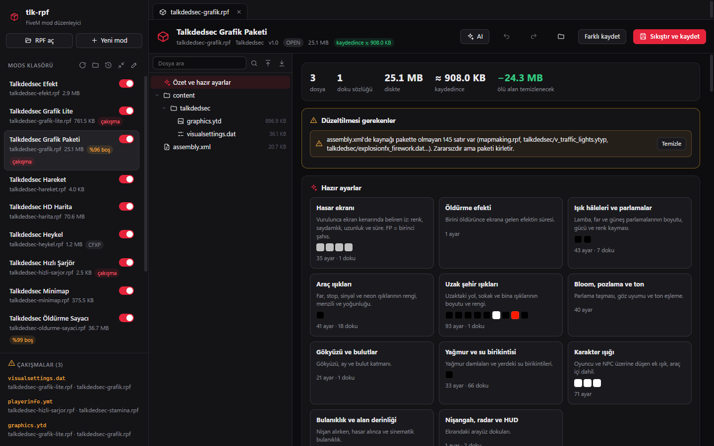
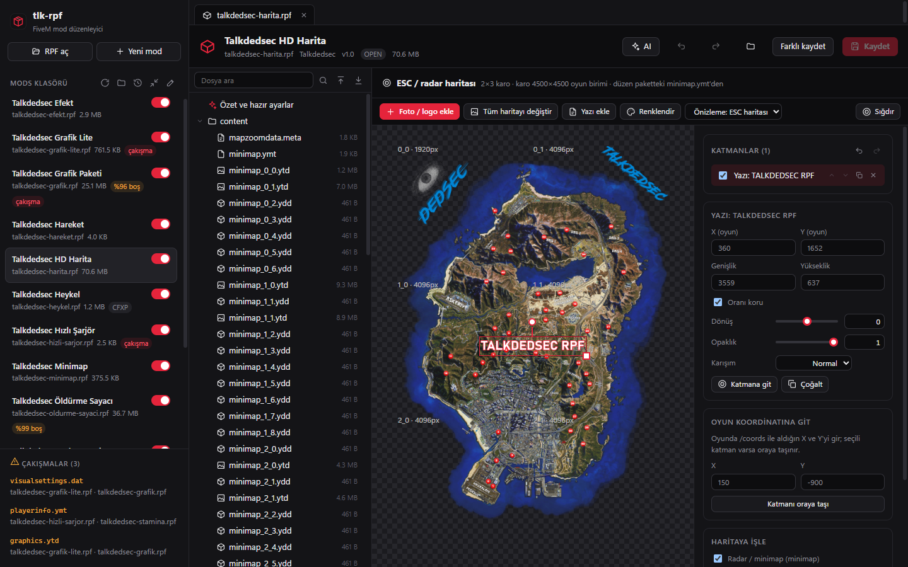
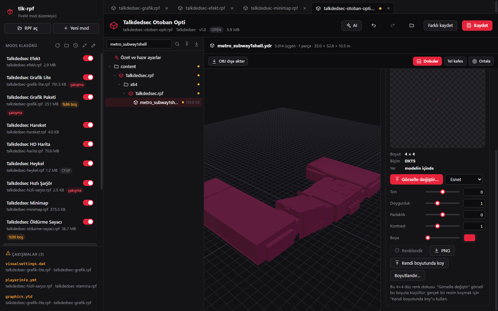
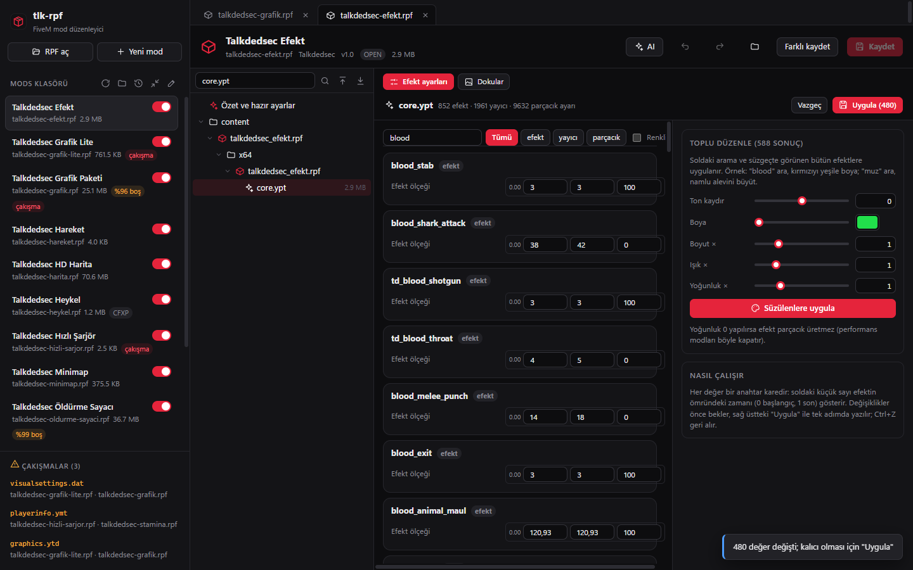
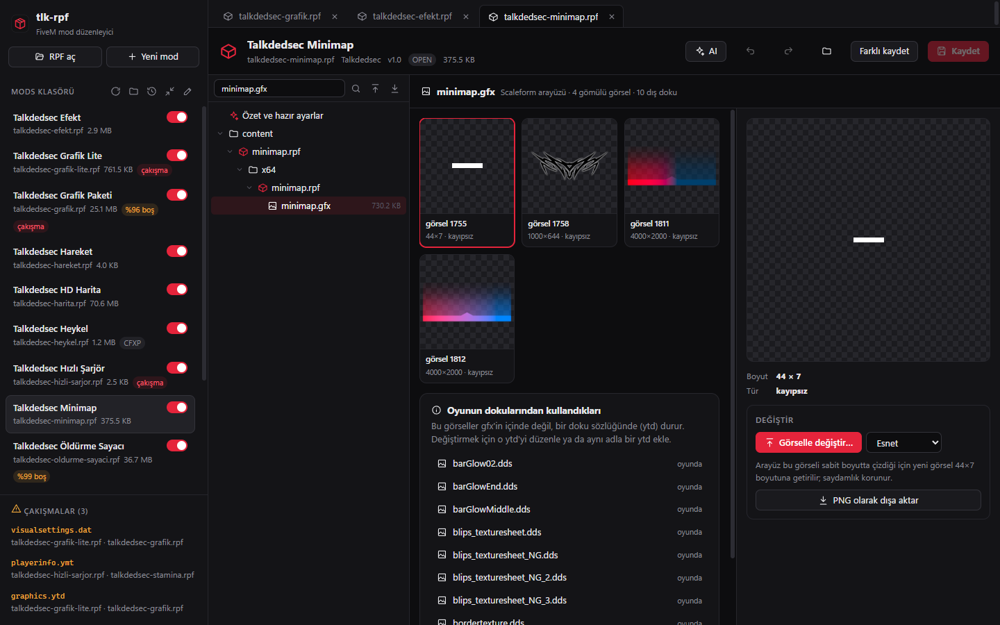
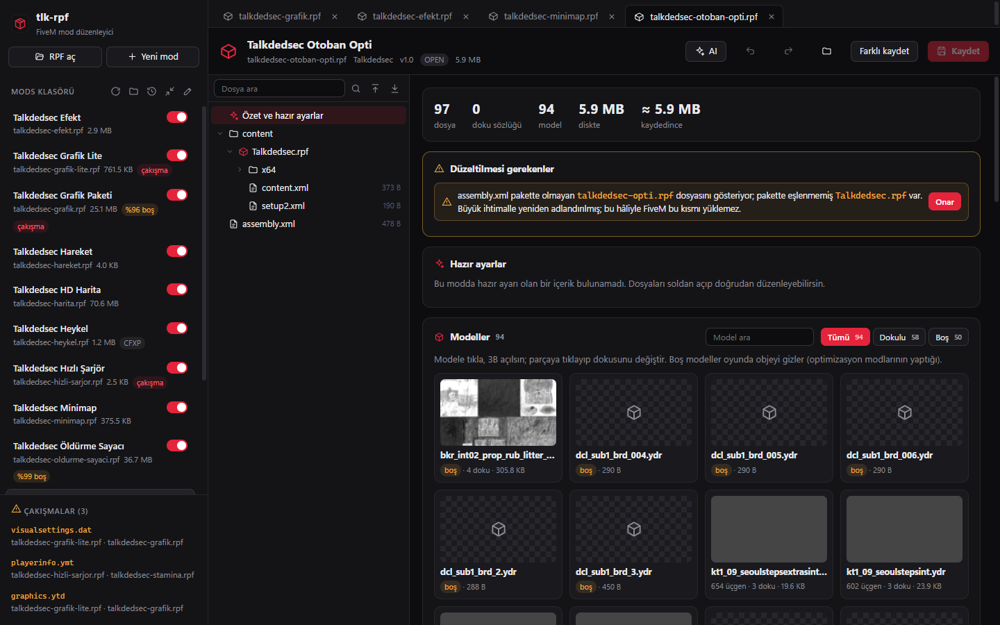
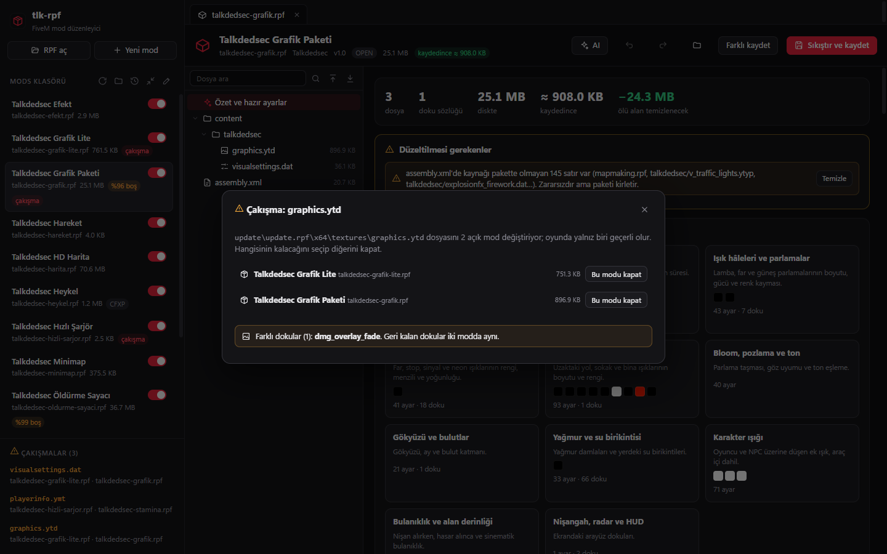

# Fltr Fivemleaktr

Fltr / Fivemleaktr markalı sürüm. Kaynak proje: [tlk-rpf](https://github.com/Talkdedsec/tlk-rpf), Talkdedsec. Mevcut bağlantılar kaynak projenin sitesine ve sürümlerine gider; Fltr indirmesi değildir. Lisans: GPL-3.0-only.

> FiveM `mods` klasöründeki `.rpf` paketleri için Windows düzenleyicisi: dokuları, görsel ayarları, parçacık efektlerini, harita karolarını ve arayüz görsellerini OpenIV'siz değiştirir; her kayıttan önce yedek alır, her değişikliği geri alınabilir tutar.

[](#)
[](https://github.com/Talkdedsec/tlk-rpf/releases/latest)
[](https://github.com/Talkdedsec/tlk-rpf/actions/workflows/ci.yml)
[](#uyumluluk)
[](LICENSE)

[Site](https://talkdedsec.github.io/tlk-rpf/) · [İndir](https://github.com/Talkdedsec/tlk-rpf/releases/latest) · [English](README.md) · [Değişiklikler](CHANGELOG.md) · [Sorun bildir](https://github.com/Talkdedsec/tlk-rpf/issues/new/choose)



## İçindekiler

- [Nedir](#nedir)
- [Neden var](#neden-var)
- [Neler var](#neler-var)
- [Hızlı başlangıç](#hızlı-başlangıç)
- [Güven ve gizlilik](#güven-ve-gizlilik)
- [Uyumluluk](#uyumluluk)
- [Nasıl çalışır](#nasıl-çalışır)
- [Bilinen sınırlar](#bilinen-sınırlar)
- [Sürüm bilgisi](#sürüm-bilgisi)
- [Yol haritası](#yol-haritası)
- [Destek](#destek)
- [Lisans](#lisans)

## Nedir

FiveM istemci modlarını `%LOCALAPPDATA%\FiveM\FiveM.app\mods` klasöründen yükler. Her mod, hangi oyun dosyasının yerine geçtiğini söyleyen bir `assembly.xml` taşıyan bir `.rpf` arşividir. fltr-rpf bu arşivleri açar, içindekileri tanır ve her dosya türüne kendi düzenleyicisini verir: `.ytd` için doku ızgarası, `visualsettings.dat` için gruplanmış ayarlar, modeller için 3B görünüm, ESC haritası için katman düzenleyici, parçacık efektleri için anahtar kare düzenleyici.

## Neden var

OpenIV bu dosyaları düzenleyebilir ama her değişiklik dışa aktar, başka programda düzenle, içe aktar ve elle paketle döngüsünden geçer; sonucun FiveM'de yüklenip yüklenmeyeceğini de söylemez. fltr-rpf bu döngüyü tek pencerede tutar ve paketi FiveM'in okuduğu gibi denetler.

| Yapar | Yapmaz |
| --- | --- |
| FiveM mods yükleyicisinin kabul ettiği OPEN ve CFXP arşivleri düzenler | NG ya da AES şifreli arşivleri açmaz (anahtarlar pakette yok) |
| Dokuları değiştirir, renklendirir, adlandırır, boyutlandırır; model ve efekt içindekiler dahil | Yeni 3B model üretmez, mesh içe aktarmaz |
| FiveM'in sessizce atlayacağı modları uyarır, bozuk `assembly.xml` eşlemelerini onarır | Oyunun ya da FiveM'in kendi dosyalarına dokunmaz |
| Her yazmadan önce yedek alır, FiveM dosyayı açık tutarken yazmayı reddeder | Oyundaki görünümü garanti etmez; bunun için FiveM'de denemek gerekir |

## Neler var

- **Mods yöneticisi.** Modları aç/kapa, aynı oyun dosyasını değiştiren modların çakışmasını gör, kopyaları karşılaştır (birebir aynı mı, hangi ayar, doku ya da satır farklı) ve birini kapat. FiveM'in yüklemeyeceği modlar nedeniyle birlikte işaretlenir.
- **Doku düzenleyici.** PNG, JPG, WEBP, TGA ya da DDS ile değiştir; ton, doygunluk, parlaklık, kontrast ve boya; adlandır, ekle, sil, boyutlandır. Bütün sözlüğü klasöre çıkar, aynı adlı dosyaları tek seferde geri koy. DXT1/3/5, BC4/5/7 ve sıkıştırılmamış biçimler, oyunun kendi mip düzeniyle.
- **Gömülü dokular.** `.ydr`, `.ydd`, `.yft` ve `.ypt` içindeki dokular yerinde düzenlenir ve büyütülebilir; oyunun dokuyu bulması için kaynağın sayfa haritası güncellenir.
- **Görsel ayarlar.** `visualsettings.dat` konulara göre gruplanır; renk seçiciler ve hasar izi, öldürme efekti, ışık haleleri, araç ışıkları, uzak ışıklar, gökyüzü, yağmur gibi hazır ayarlar. Satır düzeni, yorumlar ve tekrar eden anahtarlar korunur.
- **Parçacık efektleri (`.ypt`).** Bütün efekt, yayıcı ve parçacık kuralları renk, boyut, ışık ve yoğunluk anahtar kareleriyle. Ara (`blood`, `muz_pistol`), sonuçların hepsine ton, boya, boyut, ışık ve yoğunluk değişikliğini tek geri alınabilir adımda uygula.
- **3B görünüm.** Modeller ve çarpışma dosyaları (`.ybn`). Bir parçaya tıklayınca dokusu seçilir, değişiklik hemen görünür. Dokularıyla OBJ dışa aktarma. Optimizasyon paketleri için boş model tespitli model galerisi.
- **ESC ve radar haritası.** Oyun koordinatına foto, logo ve yazı yerleştir; döndür, ölçekle, karolara işle; işlemeyi geri alınca katmanlar geri gelir. Yalnız katmanın değdiği karolar yeniden kodlanır.
- **Scaleform arayüz (`.gfx`).** HUD ve radar dosyalarındaki gömülü görselleri gör, değiştir, dışa aktar; arayüzün oyundan çektiği dokuları listele.
- **Meta dosyaları.** `.ymt`, `.ymap`, `.ytyp` XML olarak açılır, düzenlenince ikiliye geri yazılır.
- **AI yardımcısı (isteğe bağlı).** İsteği yaz ("kanı yeşil yap", "Legion meydanına sunucu adını yaz"), aynı araçlarla yapsın. Claude, OpenAI, Gemini, Groq, OpenRouter, Ollama ya da OpenAI uyumlu herhangi bir adresle çalışır.
- **Kolaylıklar.** Ctrl+P komut paleti, son açılanlar, doku/ayar/metin içinde arama, her işlem için geri al/yinele, sıfırdan mod paketi ve tek tıkla mods klasörüne kurulum.

| | |
| --- | --- |
|  |  |
|  |  |
|  |  |

## Hızlı başlangıç

### Kurulum

1. [Son sürümden](https://github.com/Talkdedsec/tlk-rpf/releases/latest) `tlk-rpf_<sürüm>_x64-setup.exe` dosyasını indir. Kurulumsuz `tlk-rpf.exe` de ekli.
2. Dosyayı `SHA256SUMS.txt` ile doğrula ([Sürüm bilgisi](#sürüm-bilgisi)).
3. Kurucuyu çalıştır. Yalnız geçerli kullanıcıya kurar, yönetici izni istemez. Dosya kod imzalı olmadığı için SmartScreen onay isteyebilir.

### Kullanım

1. fltr-rpf'i aç. FiveM mods klasörünü kendisi bulur; *Mods klasörü* yanındaki kalem simgesiyle başka klasör seçilir.
2. Soldan bir moda tıkla. Özet ekranında önce sorunlar, sonra hazır ayarlar, dokular, modeller ve paket eşlemesi gelir.
3. Düzenle, **Ctrl+S** ile kaydet. Eski dosya önce yedek klasörüne alınır. Kaydetmeden önce FiveM'i kapat; oyun dosyayı açık tutarken fltr-rpf yazmaz.

| Kısayol | İşlem |
| --- | --- |
| Ctrl+P | Komut paleti: dosya, mod, sekme, işlem |
| Ctrl+S / Ctrl+Shift+S | Kaydet / farklı kaydet |
| Ctrl+Z / Ctrl+Y | Geri al / yinele |
| Ctrl+K | AI yardımcısı |
| Ctrl+O | `.rpf` aç |
| F2 | Seçili dosyayı adlandır |

### Kaynaktan derleme

Gerekenler: Windows 10/11 x64, Rust 1.88 ya da üstü (edition 2024), Node.js 22 ya da üstü, WebView2.

```text
git clone https://github.com/Talkdedsec/tlk-rpf.git
cd tlk-rpf
npm ci
npm run tauri build          # kurucu: target/release/bundle/nsis/
npm run tauri dev            # geliştirme
cargo test -p fltr-rpf-core   # çekirdek testleri
cargo run -p fltr-rpf-core --example kirici   # bütün ayrıştırıcılara kırpılmış ve bozuk dosya verir
```

Gerçek mod dosyası isteyen testler `testdata/*.rpf` arar. Bu dosyalar depoda yok; tam test için kendi mods klasöründen birkaç modu oraya kopyala. Yoksa dosya testleri atlanır, diğerleri çalışır.

## Güven ve gizlilik

- **Ağ.** AI sağlayıcısı ayarlamadıkça hiçbir veri makineden çıkmaz. Ayarlarsan yalnız isteğin ve yardımcının okuduğu dosya parçaları o sağlayıcıya gider. Anthropic dışındaki sağlayıcılara istekler Rust tarafından gider ve yalnız `https://` ile `localhost` adreslerine izin verilir. Telemetri ve güncelleme denetimi yok.
- **Yerel veri.** Ayarlar: `%APPDATA%\com.talkdedsec.tlkrpf\ayarlar.json`. AI anahtarları bu dosyada değil, Windows Kimlik Bilgisi Yöneticisi'nde (`tlk-rpf` adlı kayıtlar) durur; 1.0.0'ın düz metin kaydettiği anahtarlar 1.1.0 ilk açıldığında oraya taşınır. Yedekler: `%APPDATA%\com.talkdedsec.tlkrpf\yedek\`, her dosya için son 20. Her yedek geldiği tam yolu kaydeder; aynı adı taşıyan iki mod (her dlcpack'te bir `dlc.rpf` var) ayrı yedeklenir ve doğru yere geri yüklenir. Harita katmanı geçici görselleri: `%LOCALAPPDATA%\com.talkdedsec.tlkrpf\`.
- **Yazma.** Her kayıt önce geçici dosyaya yazılır, arşiv olarak yeniden okunup doğrulanır, eski dosya yedeklenir, sonra atomik olarak yer değiştirir. Şifreli arşive hiç yazılmaz.
- **İzinler.** Geçerli kullanıcı olarak çalışır; kurucu yönetici izni istemez.
- **Güvenlik bildirimi.** [SECURITY.md](SECURITY.md).

## Uyumluluk

| Ortam | Destek |
| --- | --- |
| Windows 11 x64 | Destekleniyor, test edildi |
| Windows 10 x64 | Destekleniyor (WebView2 gerekir) |
| macOS, Linux | Desteklenmiyor |
| RPF7 `OPEN`, `CFXP` | Okuma ve yazma |
| RPF7 `NG`, `AES` | Tanınır ve bildirilir, açılmaz |
| `.ytd` | Tam: görüntüle, değiştir, renklendir, adlandır, ekle, sil, boyutlandır, PNG/DDS |
| `.ydr` `.ydd` `.yft` | 3B, gömülü doku düzenleme ve boyutlandırma, OBJ |
| `.ypt` | Efekt, yayıcı ve parçacık anahtar kareleri; gömülü dokular |
| `.gfx` | Gömülü görseller: görüntüle, değiştir, dışa aktar |
| `.ybn` | Yüzey malzemesine göre 3B |
| `.ymap` | Yerleşimler 3B (salt okunur), XML düzenleme |
| `.ymt` `.ytyp` `.ymf` | XML düzenleme, ikiliye geri yazma |
| `visualsettings.dat` | Gruplanmış düzenleyici, renkler, hazır ayarlar |
| `.xml` `.meta` `.dat` `.txt` `.lua` | Metin düzenleyici |
| `.awc` `.ycd` `.gxt2` | İkili olarak gösterilir |

## Nasıl çalışır

Çekirdek (`core/`) arşiv ve kaynak biçimlerini okur ve yazar; masaüstü kabuğu (`src-tauri/`) komutları, geri alma geçmişini ve önizleme protokolünü sağlar; arayüz (`src/`) React ile yazılmıştır. Dosya dosya ayrıntı için [README.md](README.md#how-it-works).

Doku düzenlemeleri bir kaynağın düzenini baştan kurmaz. Aynı boyutta değiştirme yerinde yazılır; boyut değişince yeni piksel verisi grafik bölümünün sonuna eklenir, bölüm tek sayfaya toplanır ki hiçbir yapı sayfa sınırına taşmasın, ve kaynağın sayfa haritasındaki adetler güncellenir.

## Bilinen sınırlar

- **Oyunda doğrulama henüz yok.** Kaydedilen arşivler, büyütülmüş gömülü dokular, efekt değerleri ve arayüz görselleri dosya düzeyinde ve bağımsız bir okuyucuyla (rage-formats) doğrulandı, FiveM içinde değil. Bir değişikliğe güvenmeden önce oyunda dene.
- **Şifreli arşivler.** NG şifreli iç arşivler (ör. `RESIDENT.rpf` kullanan silah sesi paketleri) açılamıyor; ses modları şimdilik kapsam dışı.
- **Ses.** `.awc` çözülmüyor.
- **Gömülü sözlükler.** Model ve `.ypt` içindeki dokular değiştirilip boyutlandırılabilir ama eklenip silinemez.
- **Haritalar.** `.ymap` yerleşimleri 3B görünür, taşıma ve silme yalnız XML ile.
- **Bellek.** Açılan arşiv belleğe tümüyle okunur; 1–2 GB'lık harita paketleri o kadar RAM ister.
- **Büyük kaynaklar.** 32 MB üstü kaynaklar hız için varsayılan düzeyde sıkıştırılır; bu dosyalar yaklaşık %8 büyür.
- **İmzasız dosya.** SmartScreen ilk açılışta uyarabilir.

## Sürüm bilgisi

| Öğe | Nereden doğrulanır |
| --- | --- |
| Sürüm | [Sürümler](https://github.com/Talkdedsec/tlk-rpf/releases) ve `src-tauri/tauri.conf.json` |
| Değişiklikler | [CHANGELOG.md](CHANGELOG.md) |
| Bütünlük | Her sürüme ekli `SHA256SUMS.txt`; `Get-FileHash .\tlk-rpf_1.2.0_x64-setup.exe -Algorithm SHA256` |
| Kaynak | Sürüm etiketi, ör. `v1.2.0` |

## Yol haritası

- [ ] Her düzenleyicinin çevresine hata sınırı: bir çizim hatası pencereyi boşaltmasın
- [ ] Kalan eşzamanlı komutları arayüz iş parçacığından almak
- [ ] Depoda uçtan uca arayüz testleri
- [ ] Harita katman motoruyla her dokuya logo ve yazı
- [ ] Optimizasyon paketleri için boş model araçları ve kullanılmayan gömülü doku temizliği
- [ ] `timecycle_mods` düzenleyicisi ve `.gxt2` metin etiketleri
- [ ] `.ymap` yerleşimlerini 3B'de seçip taşıma ve silme
- [ ] Anahtar kaynağına karar verildiğinde NG arşivler ve `.awc` ses

## Destek

- **Hata:** [sorun aç](https://github.com/Talkdedsec/tlk-rpf/issues/new/choose)
- **Güvenlik:** [SECURITY.md](SECURITY.md)
- **Katkı:** [CONTRIBUTING.md](CONTRIBUTING.md)

## Lisans

Copyright (c) 2026 Talkdedsec.

fltr-rpf özgür yazılımdır: Free Software Foundation'ın yayımladığı GNU Genel Kamu Lisansı'nın 3. sürümü (GPL-3.0) koşullarıyla dağıtabilir ve değiştirebilirsin. Yararlı olması umuduyla, ama HİÇBİR GARANTİ olmadan dağıtılır; satılabilirlik ya da belirli bir amaca uygunluk garantisi de yoktur. Tam metin: [LICENSE](LICENSE) (İngilizce, bağlayıcı olan budur).

Kısaca: kullanabilir, inceleyebilir, değiştirebilir ve paylaşabilirsin. Değiştirdiğin bir sürümü dağıtırsan kaynağını da aynı lisansla açman gerekir. Üçüncü taraf bileşenler ve lisansları: [THIRD_PARTY_NOTICES.md](THIRD_PARTY_NOTICES.md).

fltr-rpf'in Rockstar Games, Take-Two Interactive ya da Cfx.re ile bağı yoktur. Grand Theft Auto ve FiveM sahiplerinin ticari markalarıdır.
